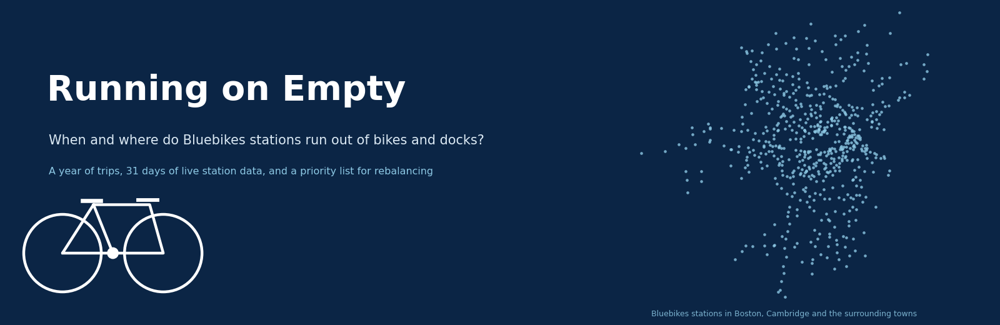
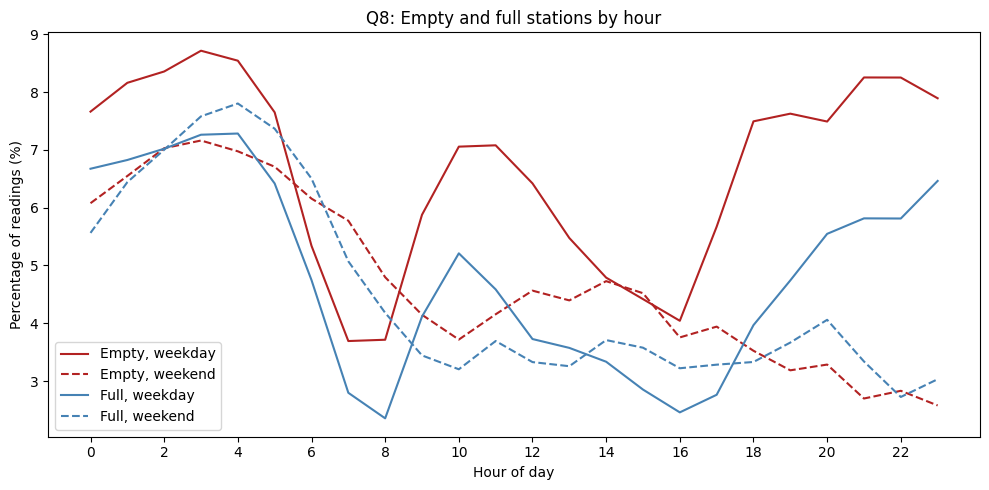
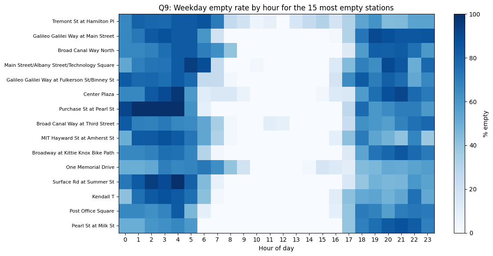
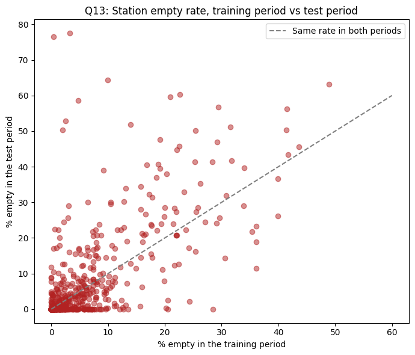
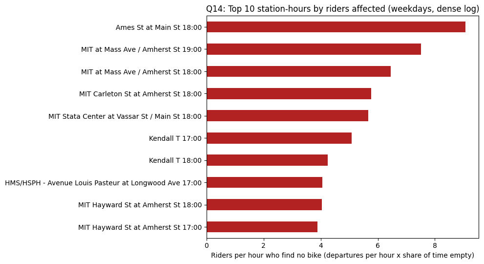

# Running on Empty: A Bluebikes Analysis

Bluebikes riders know the feeling: you walk to a station and every dock is empty, or you finish a ride and there is nowhere to return the bike. Bluebikes already sends vans around all day to move bikes between stations. This project asks a simpler question first: can anyone know ahead of time where the trouble will be? We combined a year of trip records with a month of live station readings that we collected ourselves, and used both to find the stations and hours that deserve the first van visit.

Team: Adham, Mia, Daniel, Grace and Eldo (Boston University, Cohort B, Team 10).

## Research questions

1. Where and when do shortages occur?
2. Can historical trip patterns help anticipate these shortages?
3. Which stations and hours should Bluebikes prioritize for rebalancing?

## Data

- **Trip history.** Every Bluebikes ride from September 2025 to August 2026, about 4.6 million trips after cleaning.
- **Station list.** The August 2026 station list: coordinates, municipality and number of docks.
- **Weather.** NOAA daily weather at Boston Logan Airport.
- **Live station availability.** Our own log of the Bluebikes GBFS feed: 31 daily files from September 16 to October 17, 2026, 1,542 snapshots of every station's bikes and docks. From October 7 the log has readings every ten minutes, so the hour-by-hour work uses those 11 dense days.

What each file contains, where it came from and how to get the large files is in [data/README.md](data/README.md).

## Main findings

**Shortages are concentrated in a few stations.** Over the 31-file log, 6.1% of station readings were empty and 4.8% were full. The median station is empty only 2.4% of the time, but the 20 worst stations produce 19.5% of all empty readings. The emptiest stations are office and campus stations around Kendall Square and downtown; the fullest are small residential stations at the edge of the system.

**Timing matters more than volume.** Stations are emptier overnight than during the morning rush. On weekdays the empty rate is 4.4% between 7 and 9 am and 5.7% between 4 and 6 pm, and it keeps rising into the night.

*Q8: share of station readings that are empty (red) or full (blue) in each hour of the day, weekdays solid and weekends dashed, dense period only. The morning vans leave the system best stocked around 7 am; the evening commute empties the office stations and nobody refills them until morning.*

*Q9: weekday empty rate by hour for the 15 stations most often empty. Tremont St at Hamilton Pl tops the list, empty in 46.8% of weekday readings. The pattern is the same for all 15: empty from the evening commute until the morning vans arrive, then stocked all day.*

**The trip pattern is stable all year.** 18 of the top 20 morning drainers and 18 of the top 20 fillers are the same in both halves of the year (r = 0.97), the biggest drainers lose bikes in 98 to 100% of weeks, and rain shrinks the morning drain by about 20% without changing which stations drain.

**Live shortage rankings carry forward.** We used the log up to October 14 as training data and October 15 to 17 as test days. The 20 stations with the highest training empty rate were empty 36.7% of the time on the test days, against 6.2% for all other stations, with a rank correlation of 0.70 between the two periods.

*Q13: each point is a station. Its empty rate in the training days (x) against the three test days (y). Stations that were empty often before stayed empty often, so last week's rates make a usable priority list for next week.*

**Trip history alone is not enough.** Hour for hour, the quarter of stations with the biggest morning drain are empty 1.59 times as often as average, but trip volume barely ranks stations by how often they actually run out (rank correlation -0.14). The reason is that the vans already chase the biggest drainers: we estimate about 81 refills and 69 pickups a day from jumps in the log.

*Q14: the ten weekday station-hours where the most riders find no bike, estimated as departures per hour times the share of time the station is empty. All ten are Kendall, MIT and Longwood stations between 4 and 8 pm, led by Ames St at Main St at 6 pm.*

**What we recommend.** An evening delivery loop through Kendall, MIT and Longwood from 5 pm on weekdays, starting with Ames St at Main St; pickups at the small stations that fill up; short morning shuttles between each big drainer and its nearest filler (median 0.85 km apart, 40 priority station-hours from 25 stations); and a weekly refresh of the priority list from the live feed.

## The notebook

Everything above comes from one notebook, [B10-Running-On-Empty.ipynb](B10-Running-On-Empty.ipynb), with 15 charts, all code and the saved outputs. It walks through the cleaning, the four phase-one questions, the stability checks, the live-feed analysis, the priority list and the conclusions, and ends with the references and the generative AI disclosure for the project.

## Collecting live availability data

Trips tell us where bikes go, not whether a station was empty: when the vans refill a station in time, riders still find bikes, and a rider who walks away from an empty dock leaves no trip at all. Bluebikes publishes the current state of every station in its public GBFS feed, but no history. So we wrote a small Python script, scheduled with GitHub Actions, that saves the number of bikes and docks at every station about every ten minutes and commits a daily CSV. It lives in its own repository, [AdhamKhouly/bluebikes-logger](https://github.com/AdhamKhouly/bluebikes-logger), which is where the data was collected and still grows. The script and workflow are copied into [logger/](logger/) here for reference, with a README that explains how they work, why the first weeks were thin, and what changed on October 7. The 31 daily files the notebook uses are in [data/gbfs-logs/](data/gbfs-logs/).

## Running the notebook

The notebook was written for Google Colab and reads its data from a Google Drive folder named `BA780-bluebikes`. You need the trip files (about 1 GB, downloaded from Bluebikes) plus the files in `data/`. Step-by-step instructions, including the exact Drive folder names and how to run it on your own computer instead, are in [data/README.md](data/README.md). We have not tested a run from a fresh clone of this repository.

## Limitations

The live log is short: 11 dense days in October, not the summer peak. Van visits are estimated from jumps in bike counts, not confirmed. The prediction test covers three days, one of them a Saturday, so it is early evidence rather than a proven forecast. Trip data records completed rides, not the riders who gave up at an empty station.
